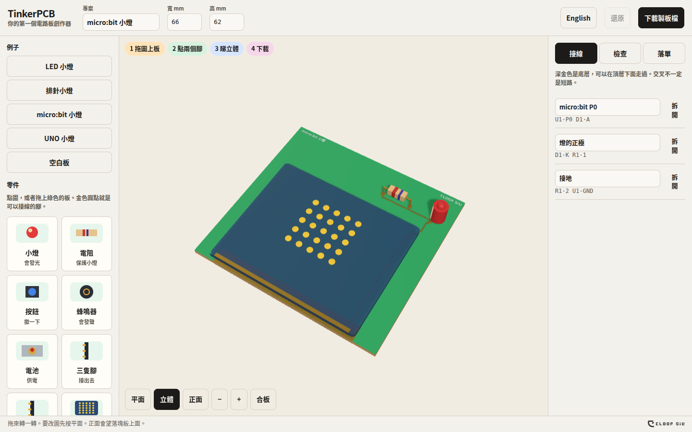
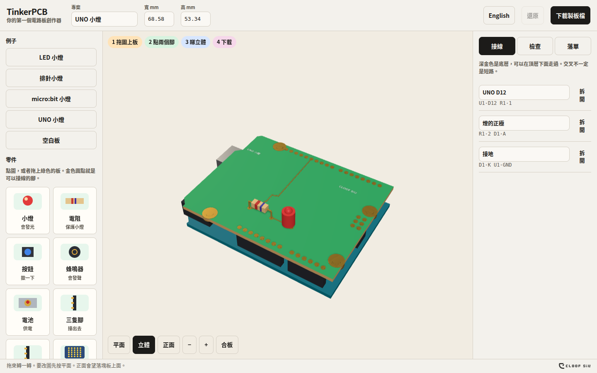
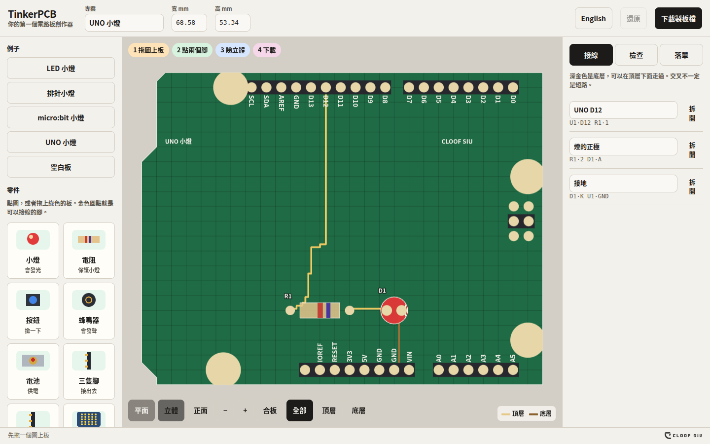

# TinkerPCB

**Your first PCB creator · 你的第一個電路板創作器**

[**Live Demo → cloofsiu.github.io/TinkerPCB**](https://cloofsiu.github.io/TinkerPCB/) · [**English Demo (`?lang=en`)**](https://cloofsiu.github.io/TinkerPCB/?lang=en)



**TinkerPCB** is a zero-install, single-lesson PCB design tool created for primary and junior-secondary STEM classrooms. Instead of overwhelming beginners with schematic capture, footprint assignment, and complex CAD menus, students go from a blank board to a real, manufacturable 2-layer PCB in four steps:

1. **Drag a part** onto the green board.
2. **Tap two gold pads** to connect them — the built-in 2-layer auto-router routes the copper traces automatically.
3. **Inspect in 3D** — orbit smoothly with WebGL (Three.js), flip underneath to inspect bottom-layer copper traces, and preview docked boards.
4. **Download the factory `.zip`** — exports standard Gerber (`RS-274X`) and Excellon drill files ready for 2-layer PCB fabrication (e.g. JLCPCB standard process).

| Arduino UNO Shield (3D Stack) | Arduino UNO Shield (2D Layout) |
| :---: | :---: |
|  |  |

---

## Classroom-First Features

- **Hand-Solder Through-Hole (THT) Parts Library**
  - **5mm LED** (Red / Amber / Green), **1/4W Axial Resistor** (`220Ω`, `330Ω`, `470Ω`, `1kΩ`), **6×6mm Tactile Button** (with internal pin-pair continuity modelled automatically), **12mm Passive Buzzer**, **20mm Coin-Cell Holder**, **1×3 & 1×4 2.54mm Pin Headers**, and **M3 Mounting Holes**.
- **BBC micro:bit Direct Edge Connector**
  - Generates 40 double-sided gold fingers at `1.27mm` pitch (`1.2 × 5.08mm` pads, no drills) mapped to the official micro:bit V2 schematic (`GND` 6-slot ring, `3V` 6-slot ring, `P0`/`P1`/`P2` 4-slot rings).
  - Auto-docks to any of the four board edges. The PCB fab manufactures the edge fingers directly — students only solder their own through-hole parts.
- **Arduino UNO R3 Shield Mode**
  - Dropping the Arduino UNO socket automatically transforms the board outline and mounting holes into an official Arduino UNO R3 shield (`68.58 × 53.34mm`), complete with Power, Analog, Digital, and ICSP headers.
- **2-Layer Auto-Router & Design Rule Check (DRC)**
  - `0.50mm` grid Dijkstra router with `0.30mm` trace width, `0.20mm` clearance, and `0.60mm / 1.10mm` vias.
  - Real-time DRC checks for out-of-bounds parts, footprint overlaps, pad-to-pad clearance, and unrouted nets (with dashed ratsnest airwires).
- **Bilingual Interface (`繁體中文` / `English`)**
  - Toggle between Traditional Chinese and English anytime, or link directly with `?lang=en`.
  - URL parameters for classroom templates: `?tpl=led`, `?tpl=header`, `?tpl=ubit`, `?tpl=uno`, `?tpl=blank`, and `?mode=flat`.

---

## Running Locally & Testing

No build step or server required — open `index.html` directly in any modern browser, or serve the folder statically:

```bash
# Run engine & Gerber export test suite
node test-pcb.js
```

---

## 課堂簡介（繁體中文）

**TinkerPCB** 專為中小學 STEM 課堂而設，讓學生在一節課內完成人生第一塊真正可以落廠生產的雙層印刷電路板（PCB）：

1. **拖圖上板**：全部採用直插（THT）零件，方便學生親手焊接。
2. **點兩個腳接線**：內置雙層自動走線引擎（線寬 `0.30mm`、間距 `0.20mm`、過孔鑽孔 `0.60mm`），自動處理頂層／底層走線與過孔。
3. **立體與平面檢視**：支援 Three.js WebGL 立體預覽，可順滑旋轉並翻到板底檢視底層銅線；無 WebGL 環境亦會自動切換至後備渲染器。
4. **micro:bit 金手指與 Arduino UNO Shield**：
   - **micro:bit 插口**：直接於板邊生成 40 格 `1.27mm` 金手指（對齊官方 V2 腳位），由板廠直接成型，學生無須焊接密腳插座。
   - **Arduino UNO 插座**：自動將電路板外框轉換為官方 R3 Shield 尺寸與腳位。
5. **一鍵匯出製板檔**：直接下載包含頂底銅層、阻焊層、絲印層、板邊及鑽孔檔的 `.zip`，可直接上傳至 JLCPCB 等板廠預覽及製作。

---

## Author & License

Designed and built by **Cloof Siu (蕭振平)** · [cv.cloofsiu.com](https://cv.cloofsiu.com) · [Instagram @cloofsiu](https://www.instagram.com/cloofsiu/) · [GitHub @cloofsiu](https://github.com/cloofsiu)

Released under the [MIT License](LICENSE).
